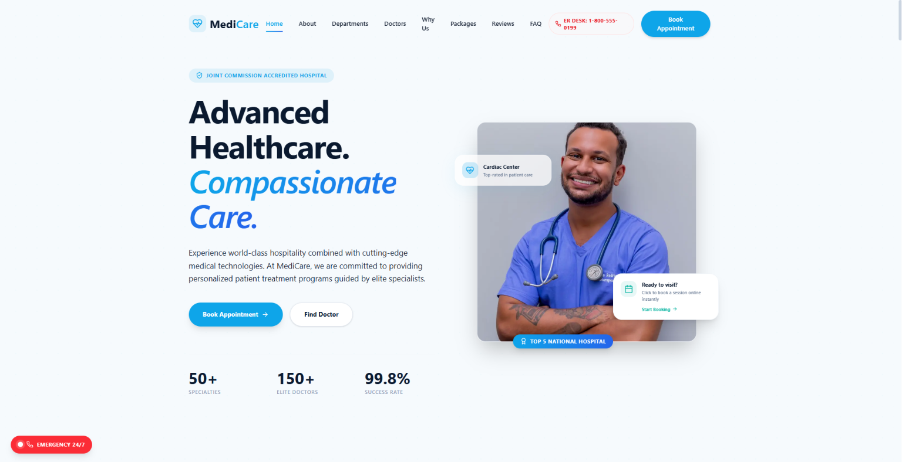
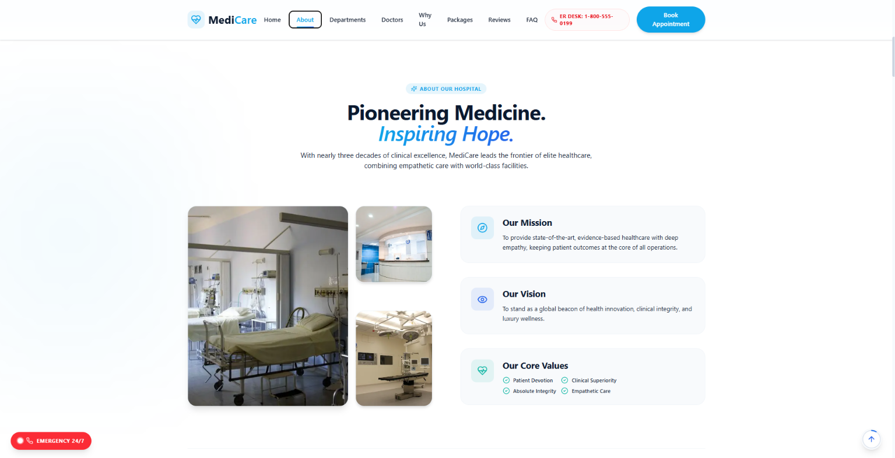
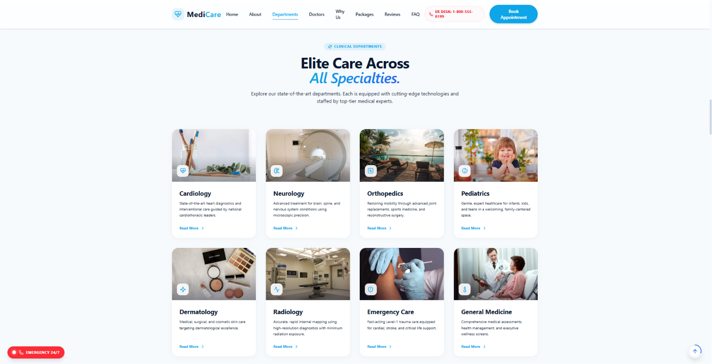
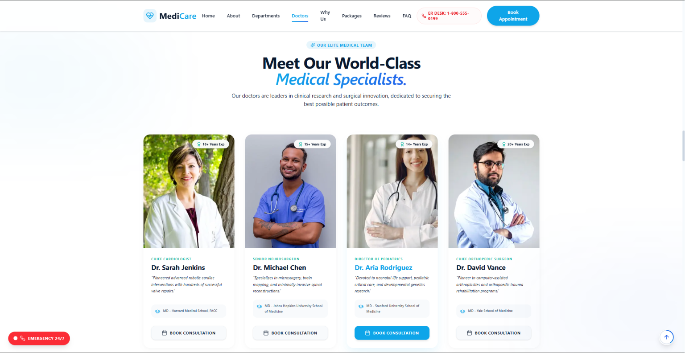
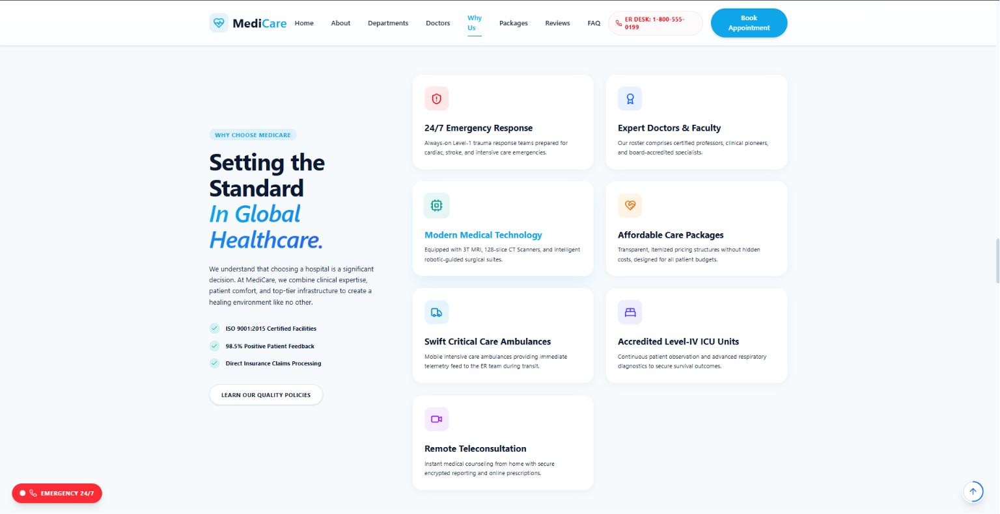
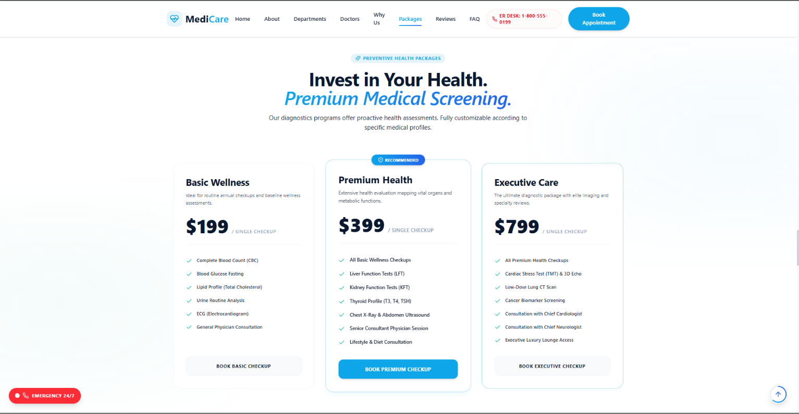
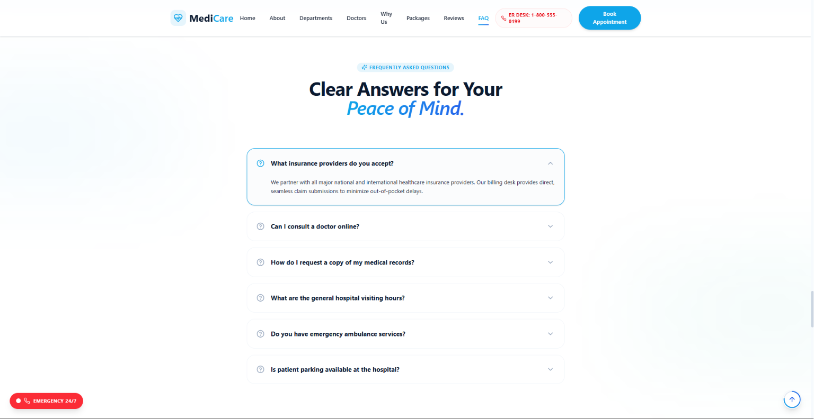
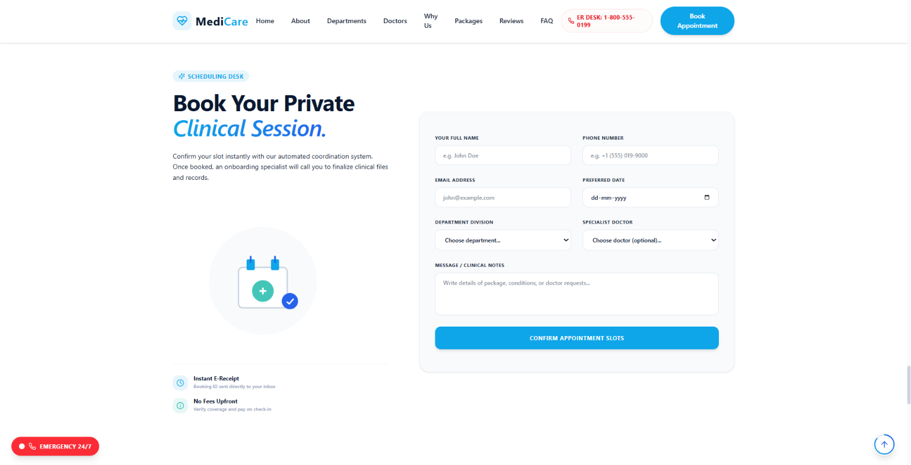
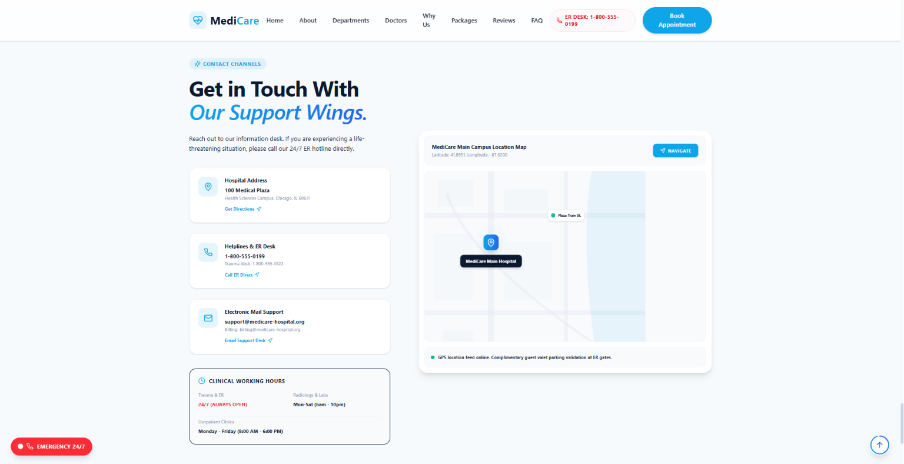
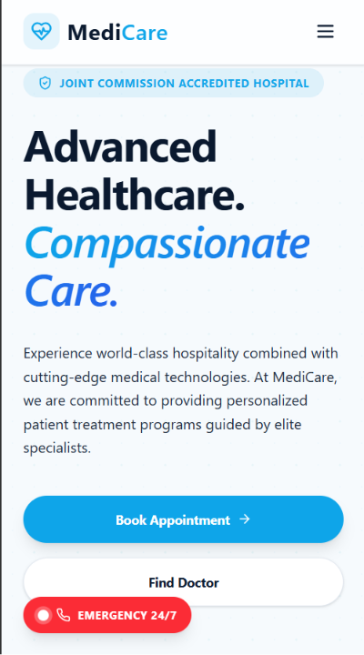

# 🏥 MediCare Hospital

A premium, fully responsive hospital and healthcare website built for multi-specialty hospitals, medical centers, healthcare clinics, and private healthcare organizations. Developed with Next.js, TypeScript, Tailwind CSS, and Framer Motion, the website provides an elegant healthcare experience with department showcases, doctor profiles, appointment booking, health packages, patient testimonials, and a modern responsive UI.

🔗 **Live Demo:** https://medicare-hospital1.vercel.app

---

# 📖 About the Project

MediCare Hospital was designed to provide modern healthcare organizations with a trustworthy and professional online presence.

Visitors can explore hospital departments, meet experienced doctors, book appointments, discover health packages, read patient testimonials, browse FAQs, and easily contact the hospital through a clean and intuitive interface.

This project was built to strengthen my frontend development skills using reusable React components, responsive layouts, premium UI/UX design, accessibility best practices, smooth animations, and production-ready web development.

---

# ✨ Features

### 🏥 Modern Landing Page

- Premium hero section
- Hospital statistics
- Emergency support CTA
- Smooth animations
- Modern responsive layout

### 🩺 Medical Departments

- Department showcase
- Department cards
- Service descriptions
- Premium UI

### 👨‍⚕️ Expert Doctors

- Doctor profiles
- Experience details
- Specializations
- Appointment buttons

### ❤️ Health Packages

- Preventive health packages
- Medical checkup plans
- Pricing cards
- Membership plans

### ⭐ Why Choose Us

- Emergency services
- Expert medical staff
- Modern equipment
- Patient-centered care
- Advanced technology

### 💬 Patient Testimonials

- Patient reviews
- Success stories
- Ratings
- Trust indicators

### 📅 Appointment Booking

- Appointment form
- Department selection
- Doctor selection
- Contact details

### 📞 Contact & Emergency

- Contact form
- Google Maps integration
- Hospital location
- Emergency contact
- Working hours

### 🎨 User Experience

- Fully responsive design
- Mobile-first layout
- Sticky navigation
- Scroll animations
- Loading animation
- Premium UI/UX

---

# 🛠 Tech Stack

## Frontend

- Next.js
- React
- TypeScript
- Tailwind CSS

## UI & Animations

- Framer Motion
- Lucide React

## Deployment

- Vercel

---

# 📸 Screenshots

### 🏠 Home & About

| Home | About |
|------|-------|
|  |  |

---

### 🩺 Departments & Doctors

| Departments | Doctors |
|-------------|----------|
|  |  |

---

### ❤️ Why Choose Us &  Health Packages

| Why Choose Us | Health Packages |
|----------------|---------------|
|  |  |

---

### 💬 faqs & Appointment

| faqs | Appointment |
|--------------|-------------|
|  |  |

---

### ❓ FAQ & Contact

| Contact |
|-------------|
|  | 

---

### 📱 Mobile Preview

<p align="center">
  
</p>

---

# 📂 Project Structure

```text
medicare-hospital
│
├── public
│   ├── images
│   └── icons
│
├── src
│   ├── app
│   ├── components
│   │   ├── common
│   │   ├── sections
│   │   └── ui
│   ├── hooks
│   └── utils
│
├── screenshots
│
└── README.md
```

---

# ⚙️ Installation

## Clone the repository

```bash
git clone https://github.com/Pulipati-Rahul/medicare-hospital.git
```

## Navigate into the project

```bash
cd medicare-hospital
```

## Install dependencies

```bash
npm install
```

---

# ▶️ Running the Project

```bash
npm run dev
```

Runs on:

```text
http://localhost:3000
```

---

# 🌍 Live Deployment

https://medicare-hospital1.vercel.app

---

# 💡 What I Learned

While building this project, I learned:

- Building premium healthcare websites
- Modern Next.js architecture
- Component-based UI development
- Responsive web design
- Framer Motion animations
- Tailwind CSS best practices
- Mobile-first development
- Accessible UI design
- SEO-friendly page structure
- Deployment using Vercel

---

# 🚀 Future Improvements

- Online patient portal
- Doctor appointment management
- Online consultation
- Electronic medical records integration
- Patient dashboard
- Payment gateway
- Health blog
- Multi-language support
- Hospital CMS
- Email notifications

---

# 👨‍💻 Author

**Pulipati Rahul**

Full Stack Developer

GitHub:  
https://github.com/Pulipati-Rahul

LinkedIn:  
https://www.linkedin.com/in/pulipatirahul

Portfolio:  
https://pulipatirahul.vercel.app

---

# ⭐ Support

If you found this project helpful, consider giving it a ⭐ on GitHub.

It motivates me to continue building high-quality projects.
